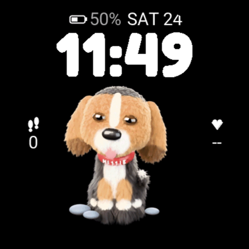
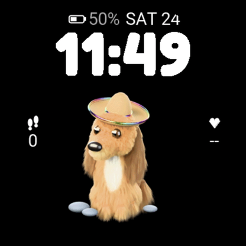
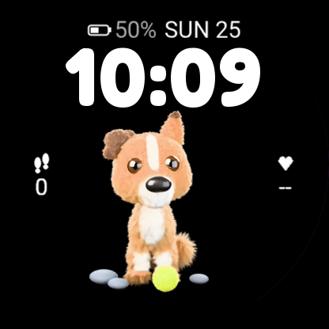
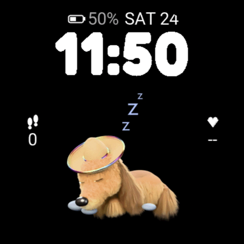

# Doggos

A Connect IQ watch face for the Garmin Forerunner 265 and 255 where three fluffy,
animated 3D dogs take turns on your wrist. Every dog is modelled in code and
rendered with Blender, so you can make your own.

| Millie | Nova | Ozzie | Nova, asleep |
|---|---|---|---|
|  |  |  |  |

- **Millie**: a tri-colour hound pup in a little captain's hat.
- **Nova**: a golden long-haired dachshund in a straw sombrero with a rainbow band.
- **Ozzie**: a red cattle dog mix with one pricked ear and her tennis ball.

Each hour the dogs take turns. The first time you look after the hour, the
dog on screen gets up and walks off (Ozzie picks up her ball first), and the
next dog, picked at random, walks in and sits down (Ozzie drops her ball,
which bounces and rolls away). She stays for the rest of the hour in a mood:

| Mood   | When                 | Animation                                        |
|--------|----------------------|--------------------------------------------------|
| sleepy | 10pm to 6am          | lying down, deep breaths, ear twitches, Zzz      |
| happy  | step goal reached    | tongue out, bouncing, fast tail wag              |
| awake  | the rest of the time | head tilt, blink, tail wag                       |

At bedtime the dog on screen lies down with a yawn and stays the night; in the
morning she gets up and hands over to the next dog. Walk-ins and walk-outs fill
the whole round screen, so the dogs trot in from off the edge and pass under
the steps and heart rate.

To choose which dogs take turns, hold Up, pick Watch Face, then Customize:
each dog has a switch. A dog switched off while she's on screen walks off
next time you look (or in the morning, if she's asleep); with every dog off,
they all take turns. The animations play while
the screen is fully on; if the screen goes off partway, the face skips to how
the story ends, and the last frame shows as a still. The battery (with percentage) and date sit at the top, then
a chunky Fredoka clock, steps on the left and heart rate on the right. The
clock and stats are drawn on a layer above the dog, so the dog never shows
without the rest of the face. In always-on mode the AMOLED screen shows only a
dim, shifting clock to stay within Garmin's burn-in rules.

## Setup

macOS with Homebrew:

```sh
brew install --cask blender     # Blender 5.x renders the dogs
brew install ffmpeg libmtp openjdk@17
```

- **Connect IQ SDK**: install the SDK Manager from
  https://developer.garmin.com/connect-iq/sdk/, then download the latest SDK
  and the Forerunner 265 device files (needs a Garmin login).
- **Java 17**: `export JAVA_HOME=/opt/homebrew/opt/openjdk@17/libexec/openjdk.jdk/Contents/Home`
  in your shell profile.
- **Developer key**: every Connect IQ app is signed. Make one once and keep it
  out of the repo:

  ```sh
  openssl genrsa -out developer_key.pem 4096
  openssl pkcs8 -topk8 -inform PEM -outform DER -in developer_key.pem -out developer_key.der -nocrypt
  ```

  The Makefile looks for `~/workspace/garmin/keys/developer_key.der`; pass
  `KEY=/path/to/developer_key.der` to use another location. Keep the key: store
  updates must be signed with the same one.

## Commands

| Command | What it does |
|---|---|
| `make run` | Build and open in the simulator (`DEVICE=fr255` for the Forerunner 255; the default is `fr265`) |
| `make install` | Build and copy onto a USB-connected watch (close Garmin Express first) |
| `make package` | Build `bin/Doggos.iq` for the Connect IQ Store |
| `make frames`, `make preview` | The original single-pose renders (`dog.py`, used for the store art) and their review GIFs |
| `make test` | Unit tests (`test/`) in the simulator |
| `make rig` | Render dogs on the shared skeleton into `build/frames/rig/` (`DOGS="ozzie nova millie"`, `ANIMS=walkin` narrows it; `SIZE=300` renders at the watch's size, ~15 s a frame with fur) |
| `make art` | Encode the skeleton renders into the watch resources, at each screen size, and `source/Dogs.mc` |
| `make rig-preview` | Watch-size GIFs of the skeleton renders, plus a "story" GIF: walk in, sit, walk out |

Quick single-frame preview while you tweak a dog (`--no-fur` takes seconds):

```sh
/Applications/Blender.app/Contents/MacOS/Blender --background --python tools/blender/dog.py -- \
    --dog nova --mood awake --still build/preview.png [--no-fur]
```

## How the dogs are made

Following [Simon Willison's approach](https://til.simonwillison.net/llms/blender-coding-agents-macos),
everything is built in code in `tools/blender/dog.py`:

1. Each dog is sculpted from blended metaball ellipsoids (body, head, ears,
   tail), converted to a smooth mesh, and covered in particle fur with the
   Principled Hair BSDF.
2. Markings are procedural: coloured ellipsoid patches with noisy edges, so
   the same coat paints the skin and the fur.
3. Props are built in code too: Nova's straw sombrero, Ozzie's tennis ball and
   Millie's collar lettering (Fredoka, from `tools/fonts/`).
4. The dogs are posed and animated on a shared skeleton (see below) and
   rendered with Cycles on a transparent background at 10 fps.
5. `tools/build_art.sh` flattens the frames onto black and fits them to the
   watch: the walks fill the whole round screen, so dogs come and go off its
   edge under the steps and heart rate; the loops and lying down are cropped
   to the dog's box below the clock, with its sides faded. It encodes each clip
   with Garmin's Monkey Motion (`monkeym`), and writes the resource XML and
   `source/Dogs.mc`, the list of dogs the watch face rotates through. "Get up"
   is "lie down" played backwards.

Animations stream from the app's resources rather than memory, so the face
uses only a small part of its 128 KB memory limit. Each dog has seven clips
(three mood loops, walk in, walk out, lie down, get up). The art is made at
each screen size in `build_art.sh`'s `SCREENS`, and each watch gets only its
own size: about 20 MB on the FR265 (it allows 64 MB) and 5 MB on the FR255,
whose 64-colour screen needs far less. The layout is designed for the FR265's
416px screen and scaled (`source/DogLayout.mc`); each size has its own clock
font from `tools/make_font.py --size`.

### Make your own dog

1. Sculpt a head in `tools/blender/dog.py` (copy `nova_head` or
   `millie_head` as a starting point) and add it to `HEADS` in
   `tools/blender/dog_rig.py`.
2. Add a spec to `SPECS` in `tools/blender/dog_rig.py`: body shape, leg
   heights, coat, tail, head and fur style (see below).
3. Check the shape and poses quickly with `--anim poses --no-fur`, then
   render: `make rig DOGS=<name> SIZE=300` (about an hour with fur).
4. Add the name to `DOGS` in `tools/build_art.sh` (or pass it, as in
   `DOGS="<name>" make art` for a face with only your dog).
5. `make run` to see it in the simulator, `make install` to put it on your watch.

To publish your own version, change the app `id` in `manifest.xml` and the
name in `resources/strings/strings.xml`.

## The skeleton: one rig for every dog

`tools/blender/dog_rig.py` puts every dog on the same skeleton, so they all
stand, walk, sit and lie down the same way. A dog is a spec in `SPECS`: its
torso (metaball ellipsoids), leg attachment points and heights, coat colours
and patches, tail, head (from `dog.py`), fur length and a fur style. The legs,
the bones and the poses come from the spec, so a new dog is mostly numbers:
Nova's spec is "short legs, long body, gold coat, silky fur, sombrero head".

- **Skinning:** the body and legs are one sculpt bound to the armature (spine
  pivoting at the shoulders, chest, neck, two-joint legs with paws, a four-bone
  tail) with Blender's automatic weights; the head hangs off the neck bone.
  Every move is a real bend at the joints, and the fur rides along.
- **Poses** are bone angles shared by every dog: standing, sitting, lying (a
  sphinx: front legs out, hind legs tucked). How far a dog drops lying scales
  with its leg height, and how far the spine tilts sitting with its body length
  (so a long, low dachshund sits on her rump instead of through the floor); a
  spec can adjust any pose.
- **Fur styles:** coarse (Ozzie), silky (Nova: long, glossy, wavy locks) and
  fluffy (Millie: soft and frizzy) set how strands clump, wave and frizz, how
  thick they are, and how glossy.
- **Walking** is a four-beat walk cycle (left hind, left front, right hind,
  right front) driven by distance travelled, so paws don't slide as the dog
  speeds up or slows down; the body bobs, the head nods, the tail swings.
- **Animations** (`--anim`):
  - `walkin`: trots in from off screen carrying the ball, curves round toward
    the camera as she slows (head first, feet stepping through the turn),
    drops the ball and sits. Its last frame is the sitting
    loops' first.
  - `walkout`: stands, steps to the ball and picks it up, then curves away,
    head first, and trots off screen.
  - The walks are framed to the whole watch screen (`frame_full_face`: a
    wider, shifted camera view, so the dog lands exactly where the loops' crop
    puts her); everything else is framed to the dog's box.
  - `awake`, `happy`: sitting loops; `sleepy`: lying with her head on her paws.
  - `liedown`: from sitting to lying with a yawn, for the dog who stays the night.
  - `poses`: the key poses side-on and three-quarter, for checking a new dog.
- **The ball** is simulated when dropped: gravity, bounces that lose height and
  speed (sub-stepped at 1 kHz so bounces land between frames), then rolling to a
  stop, spinning the right way. Walk-ins and walk-outs use motion blur, which
  smooths the bounce and the walk at 10 fps. The walk-out steps to wherever the
  ball came to rest.

Every animation on the watch comes from the skeleton. Each walk-in ends on
the awake loop's first frame, and each loop and transition joins the next
without a jump. `make rig-preview` makes review GIFs of everything.

## Layout

- `source/DogFaceView.mc`: the face, mood logic, animation playback
- `source/DogLayout.mc`: where the dog goes on each screen size
- `source/DogPicker.mc`, `source/DogSettings.mc`: which dogs take turns, and
  the on-watch settings menu
- `source/Story.mc`: what the dogs do and when (walk out, walk in, lie down,
  get up), as a queue of clips. These three are tested in `test/`
- `source/Dogs.mc`: the dog list (generated by `build_art.sh`)
- `resources-round-416x416/`, `resources-round-260x260/`: the clock font,
  Monkey Motion animations and still frames for each screen size (generated)
- `tools/blender/dog.py`: the dogs, props, scene and animations
- `tools/blender/dog_rig.py`: the shared skeleton, dog specs, poses, walk cycle, ball physics and animations
- `tools/render_rig.sh`, `tools/preview_rig.sh`: render and preview the skeleton animations
- `tools/build_art.sh`: encodes the skeleton renders for the watch
- `tools/render_frames.sh`, `tools/preview_gifs.sh`: the original single-pose renders
- `tools/make_font.py`: turns `tools/fonts/Fredoka.ttf` (SIL OFL) into the clock's bitmap font
- `store/`: Connect IQ Store listing and screenshots
